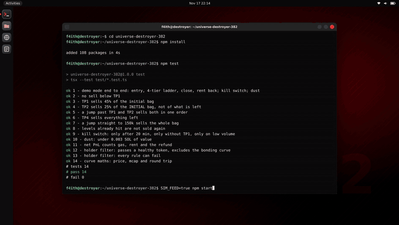
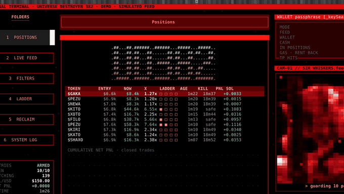
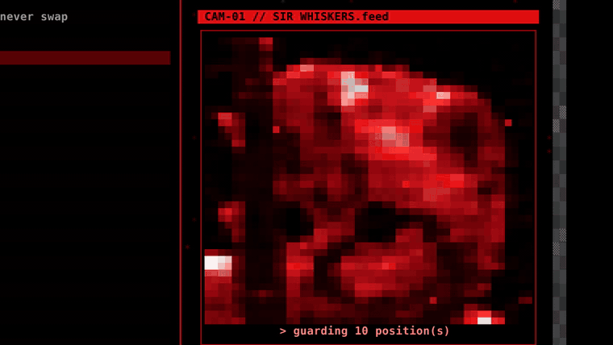
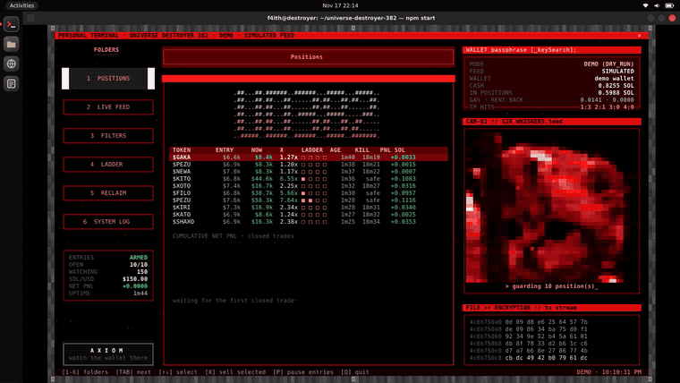
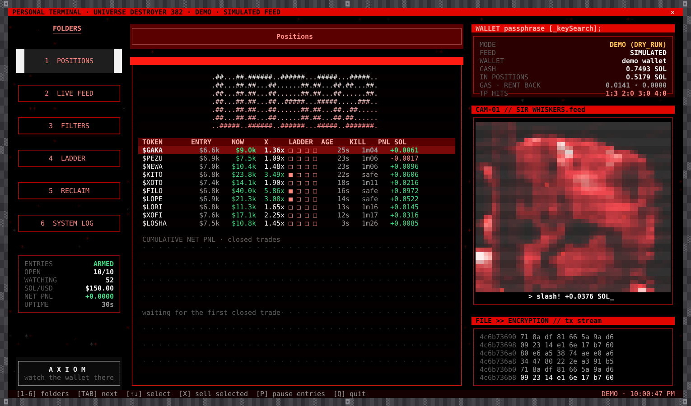
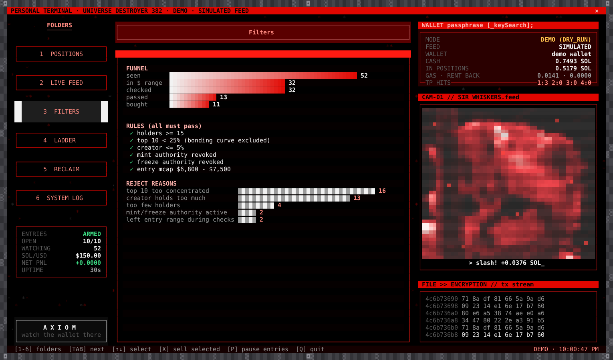
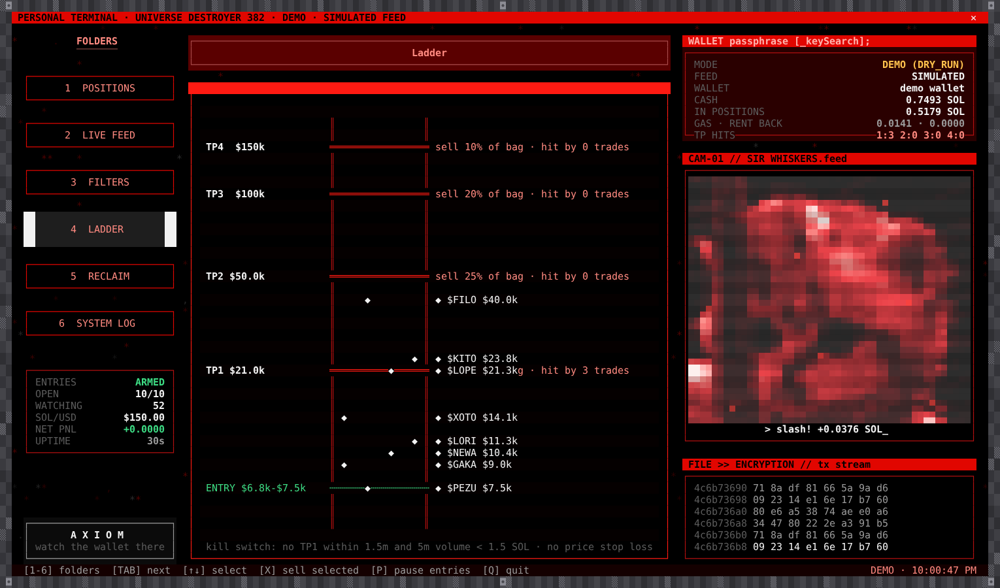

# UNIVERSE DESTROYER 382

A headless Solana memecoin bot with its own red terminal. It catches pump.fun tokens around a **$7,000 market cap**, checks that they're safe, buys **0.03 SOL** each, and takes profit on a **4-step ladder**. If a token goes nowhere, a **time-based kill switch** sells it. Leftover dust gets burned so you get the account rent back.



**[Watch the full demo video](docs/demo.mp4)** · [Quick start](#quick-start) · [The strategy](#the-strategy) · [Live mode](#live-mode)

> **Start in demo mode.** `DRY_RUN=true` (the default) uses real market data but simulated buys and sells. No SOL is spent, and every trade, fee and result is saved so you can judge the strategy first.

---

## Quick start

You need **Node.js 20 or newer**.

```bash
npm install
cp .env.example .env

# 1. try it offline: an invented market, nothing real (no keys, no network needed)
SIM_FEED=true npm start

# 2. demo on the real market: real launches and prices, simulated trades
#    put your RPC_URL in .env first (Helius free tier works)
npm start

# 3. see how the demo did
npm run report
```

Live trading is `DRY_RUN=false` plus `PRIVATE_KEY` and `RPC_URL` in `.env`. Read the Live mode section first.

**Keys in the terminal:**

| Key | Does |
|---|---|
| `1`-`6` / `TAB` | switch folder: Positions, Live feed, Filters, Ladder, Reclaim, System log |
| `↑` `↓` | select a position |
| `X` then `Y` | sell everything left in the selected position, now |
| `P` | pause new entries (open positions are still managed) |
| `Q` | quit (state is saved; open positions are picked up on the next start) |

The terminal needs at least **110 x 34** characters. The wallet panel and the CAM-01 cat show from **150** wide. On a server, run `npm start -- --headless` for plain logs.

## See it work

| | |
|---|---|
|  |  |
| **Six folders.** Positions, live feed, filter funnel, take-profit ladder, rent reclaim, system log. | **CAM-01.** The knight cat guards your positions and reacts to every buy and sell. |
|  |  |
| **X then Y** sells what's left of a position, right now. | **Positions:** entry, live market cap, multiple, ladder progress, kill-switch timer, PnL. |

*The GIFs and video are filmed on the offline demo market (`SIM_FEED=true`), so the title bar says DEMO · SIMULATED FEED.*

## The strategy

| | |
|---|---|
| **Bankroll** | 1.0 SOL minimum to start live. 0.03 SOL per trade. Max 10 open at once. |
| **Entry** | market cap between **$6,800 and $7,500** |
| **Safety checks** (all must pass) | at least 15 holders · top 10 hold under 25% (the bonding curve isn't counted) · creator holds 5% or less · mint and freeze authority revoked |
| **Fees** | priority fee 0.0005 SOL + Jito tip 0.0005 SOL per swap · slippage 18% |
| **Exits** | no price stop loss. The 0.03 SOL entry is the max risk. |

**Take-profit ladder** (percent of the **first** bag, on live market cap):

| Level | Market cap | Sells | |
|---|---|---|---|
| TP1 | $21,000 (~3x) | 45% | pays back the entry, gas and rent |
| TP2 | $50,000 (~7.1x) | 25% | |
| TP3 | $100,000 (~14.3x) | 20% | |
| TP4 | $150,000+ (~21.4x) | the last 10% | |

If the price jumps past several levels between two updates, those levels sell together in one swap.

**Kill switch:** if a token hasn't reached TP1 **20 minutes** after the buy **and** its 5-minute volume is under `KILL_MIN_VOL_5M_SOL` (1.5 SOL by default), the rest gets sold.

**Dust and rent:** when a position is worth less than **0.003 SOL**, swapping it would cost more than it returns. The bot burns the tokens instead and closes the token account, which returns about **0.00204 SOL** of rent. Empty accounts after a full exit are closed the same way. This runs in batches of 8 accounts per transaction.

## How it's built

```
src/
  stream.ts           PumpPortal websocket (new tokens, trades, migrations) + bonding-curve poller + 5-minute volume
  filters.ts          on-chain checks: holders, top 10, creator share, mint/freeze authority
  executor.ts         PumpPortal local transactions, signed here, sent as a Jito bundle [swap, tip]; demo executor
  positionManager.ts  take-profit ladder, kill switch, dust rule, manual sell
  rentReclaimer.ts    burn dust + close token accounts in batches, rent back to the wallet
  bot.ts              wires it all together: watchlist, entry window, cash checks
  tui.ts              the terminal (Positions, Live feed, Filters, Ladder, Reclaim, System log, CAM-01)
  curve.ts            bonding curve maths     price.ts  SOL/USD from Jupiter
  db.ts               JSON database (data/db.json): every buy, sell, fee and rent refund
  simFeed.ts          offline market simulator (SIM_FEED=true, demo only)
  report.ts           npm run report
  config.ts           every setting, read from .env
test/                 npm test: ladder, kill switch, dust, filters, curve maths, full demo run
assets/cat.json       the CAM-01 cat, as pixel frames
docs/                 screenshots, GIFs and the demo video
```

**Packages:** `@solana/web3.js`, `@solana/spl-token`, `ws`, `bs58`, `dotenv`. Dev only: `typescript`, `tsx`, `@types/node`, `@types/ws`. The terminal is plain ANSI, with no UI library.

**Market data:**
- **New launches** come from PumpPortal's free websocket.
- **Prices and volume** come from one of two sources:
  - With `PUMPPORTAL_API_KEY`: PumpPortal's trade stream. It's the fastest and the most accurate for volume. It needs a PumpPortal account with a linked wallet holding at least 0.02 SOL, and costs 0.01 SOL per 10,000 messages.
  - Without a key: the bot reads each token's bonding curve from your RPC every 2.5 s. That's free, but volume is only an estimate (a lower bound).
- **After a token migrates to PumpSwap**, its price comes from Jupiter.

**Execution:**
1. PumpPortal's Local Transaction API builds the swap with your priority fee and `pool=auto`, so it works before and after migration.
2. The bot signs it locally. Your key never leaves your machine.
3. It sends the swap to Jito in a bundle with a separate tip transaction, and also pushes it through your RPC.
4. Once the swap confirms, the bot reads the real token amount, SOL, fees and rent from the confirmed transaction.

## Live mode

1. Use a **new wallet** with only what you're willing to lose, at least 1.0 SOL.
2. Use your **own RPC**. The holder checks use `getProgramAccounts`, which the public endpoint refuses.
3. Get a **PumpPortal API key** if you can. Without it, prices lag by up to 2.5 s and the kill switch's volume check is rough.
4. In `.env`, set `DRY_RUN=false` and fill in `PRIVATE_KEY` and `RPC_URL`.
5. Watch the first trades: every buy and sell is in `data/db.json` with its transaction signature, and you can follow the wallet on Solscan or Axiom.

**About Axiom:** Axiom has no public trading API, so the bot can't place orders through it. It trades the same pump.fun and PumpSwap pools through PumpPortal. You can still watch the bot's wallet on Axiom. The badge in the bottom-left corner of the terminal is a reminder of that.

## Know the risks

- Most tokens at $7k go to zero. The strategy relies on a few runners paying for many small losses, so losing streaks are normal.
- With no stop loss, every entry can lose the full 0.03 SOL plus about 0.001 SOL gas.
- Fast tokens can blow through the slippage limit, and failed swaps still cost fees.
- The holder checks catch some rugs, not all of them. Bundled wallets can look like many holders.
- This is software, not financial advice. Run the demo first and read `npm run report` before risking anything.

## Settings

Everything lives in `.env`. `.env.example` lists every option with its default. The main ones:
- `POSITION_SOL`, `MAX_OPEN_POSITIONS`
- `ENTRY_MCAP_MIN_USD` / `ENTRY_MCAP_MAX_USD`
- `MIN_HOLDERS`, `TOP10_MAX_PCT`, `CREATOR_MAX_PCT`
- `TP1_MCAP_USD` … `TP4_SELL_PCT` (the sell percentages must add up to 100)
- `KILL_AFTER_MIN`, `KILL_MIN_VOL_5M_SOL`, `DUST_SOL`
- `PRIORITY_FEE_SOL`, `JITO_TIP_SOL`, `SLIPPAGE_PCT`

| | |
|---|---|
|  |  |
